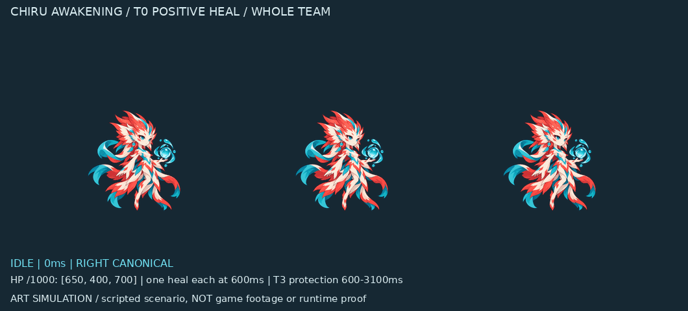

# 赤鱬 Awakening「潤澤」動作／VFX／GIF 審核

狀態：**F3 已核准；本次新動作／獨立 VFX／13 份 GIF 待玩家核准。**

這是依核准契約製作的美術情境示範，尚未整合遊戲或部署。角色本體與水冠扇幕、泉花、保護水膜分離；核准 F3 原圖、padding 與 safe cell 完整保留。

先看 [正常版](chiru-awakening-normal.gif)、[慢速版](chiru-awakening-slow.gif)、[無獨立 FX](chiru-awakening-noFX.gif)，再看 [T3 正治療＋保護](chiru-awakening-t3-positive.gif) 與 [滿血僅 T3 保護](chiru-awakening-full-hp-protection.gif)。

| 預覽 | 審核重點 |
|---|---|
| [慢速](chiru-awakening-slow.gif) | 低位開掌 → 肩高托舉 → 核准雙臂高 V → 回收 |
| [無獨立 FX](chiru-awakening-noFX.gif) | 本體動作與 Basic／Heavy／Special 區別；原配件水珠保留 |
| [左向鏡像](chiru-awakening-left-mirror.gif) | 全畫面精確 mirror，配件隨角色翻轉 |
| [回 Idle](chiru-awakening-idle-return.gif) | 1200ms 返回原已核准 Idle |
| [減動](chiru-awakening-reduced.gif) | 固定完整效果輪廓；保護依情境到期 |
| [T3 正治療＋保護](chiru-awakening-t3-positive.gif) | 全體三位含自身，各一次正治療；保護 600–3100ms |
| [滿血僅保護](chiru-awakening-full-hp-protection.gif) | amount=0，沒有虛構泉花；保護仍真實存在於示範情境 |
| [600ms 前取消](chiru-awakening-cancel-before600.gif) | 500ms 取消，不給治療／保護／泉花 |
| [Special 同尺度 FX-on](awakening-vs-special.gif) | 共同施法起點、相同角色尺度；潤澤更完整水冠與全隊泉花 |
| [Special 同尺度 FX-off](awakening-vs-special-noFX.gif) | 單高托單低展 vs 雙臂高 V |
| [390px 全景](chiru-awakening-phone-390.gif) | 整張等比縮小，未個別放大角色；不是實機測試 |
| [獨立 FX](chiru-awakening-fx-only.gif) | 三種獨立 raster 效果與時序 |

情境：三位存活同隊含自身，每位 maxHp=1000，HP 起始 650／400／700。T0 於 600ms 各治療 160；T3 於 600ms 各治療 300（缺血封頂）。滿血情境不畫泉花；T3 保護 10.8%／2.5 秒，示範 3100ms 到期。T2 後排 +5% 未在此固定情境啟用；不套回瀾低血 +10%。這些都是預覽腳本數值，並非新遊戲驗證。

F1/F2/F3/F4＝360/240/300/300ms。每份 GIF 附逐段 timeline；全解碼逐像素／hold 對照通過，最短解碼 hold 20ms（慢速 60ms）。GIF 編碼時長不等於實機播放證明。

共同 320×260 cell，chestX158／hoverY203，F3 .13 基準；新增 source 用頭身地標等比正規化，不按整張 canvas 或最高水冠 fit。原像素 padding／縮放反貼／四 cell strip／mirror roundtrip 通過；245 個 protected hashes 保持。原檔微弱 alpha 邊緣像素全部保留，僅外加 128px 透明 padding；明暗底可見輪廓無裁切。F2 首稿過近 F3，保留 originals/F2-attempt1.png，不採用；只有一次針對性修正。

自審圖：[姿勢明暗底](poses-light-dark-QA.png)、[左右配件](mirror-light-dark-QA.png)、[FX 明暗底](fx-light-dark-QA.png)、[合成明暗底](composite-light-dark-QA.png)、[四招無 FX](four-skill-noFX-QA.png)、[各自峰值比較](comparison-own-peaks.png)。形象／尺度／差異／場面為作者自審，最終視覺接受由玩家判定。

重建：在 repo 執行 `python docs/art/candidates/chiru/awakening/composite-review-v1/prepare_preview.py`。完整 prompts、原圖、generation-inputs、manifest、checksums 及 protected-hashes 同目錄。

**唯一下一 Gate：玩家明確核准本次 GIF 或指出修正。未獲核准不得 Runtime／部署／Passive；不建立 acceptance。**
