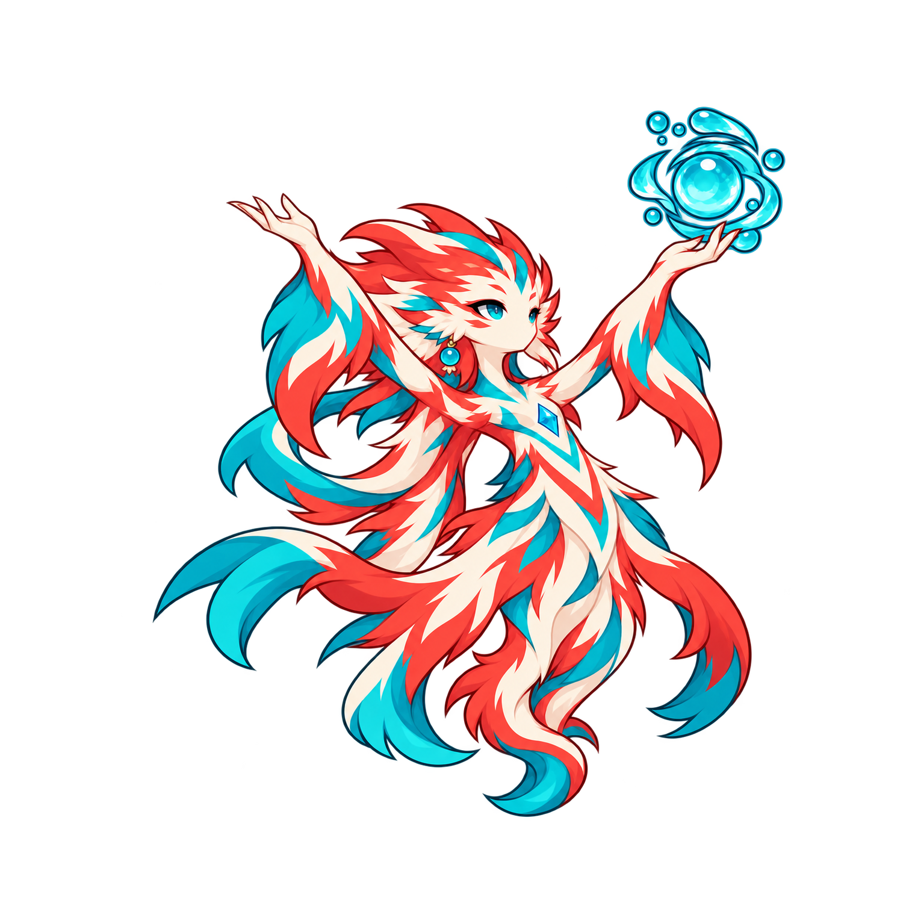

# 潤澤 Awakening — F3 v2 單張候選

CANDIDATE / PLAYER F3 REVIEW PENDING。內建 imagegen，僅一張本體姿勢。

雙臂高V、雙掌高於眼部；右手仍托原青色珠環、可見側青珠耳飾保留。與Basic水平前射、Heavy屈肘前推、Special單高托/單低展分開。角色頭身不放大；同 .13 審核像素密度、320×260 cell、chestX158/hoverY203。原圖1254×1254，僅四邊加128透明padding至1510×1510；保留所有原像素及微弱alpha點，不裁切、不去色、不截斷解碼。

原圖SHA256 a822aa2e918472ade44d1432ff71f1d4d493df22c28a1455fd123ea0d47c561a；候選SHA256 7f23b33b22196ef59e0e996b4a901db5134280a0731f17f17d0e9ab511d3d340。完整prompt見prompt.txt，參考hash/實際幾何/限制見manifest.json；舊損壞batch與original/prompt/manifest全部保留。

QA：`python docs/art/candidates/chiru/awakening/f3-v2/prepare_qa.py`。PNG verify及load、RGBA透明/安全padding、原像素反貼、縮放反貼、雙mirror、5張核准參考hash PASS。深淺底/共同尺度/左右配件/臉型為作者自審，非獨立審核或玩家核准。qa-scale-dark/light.png為靜態同尺度比較；qa-mirror-*為精確鏡像；qa-390-static.png只是縮小靜態觀察，不是實機測試。

必要機制差異沿用P3_AWAKENING_PREFLIGHT/runtime-readonly.json，並讀目前abilities/ability/battleSession/tierEffects來源：仍instant/舊.16基數與舊healing scale、T3 cast即保護。600ms新時序/Tier當前maxHp治療/結算時保護尚未實作。共用Special基礎能力已存在，後續只補generic team opt-in等差異。

本次未做獨立水冠扇幕、泉花、保護水膜；Awakening更大場面須在後續獨立VFX/GIF以相同角色尺度驗證。此張不能宣稱完整場面升級已完成。未產其餘姿勢、GIF、Runtime、部署或Passive；無新acceptance。

唯一下一步：玩家審核這張F3，明確核准或提出修正。F3核准後才進其餘動作/獨立VFX→GIF核准→Runtime/必要真驗證/正常Pages→遊戲核准→Passive。
