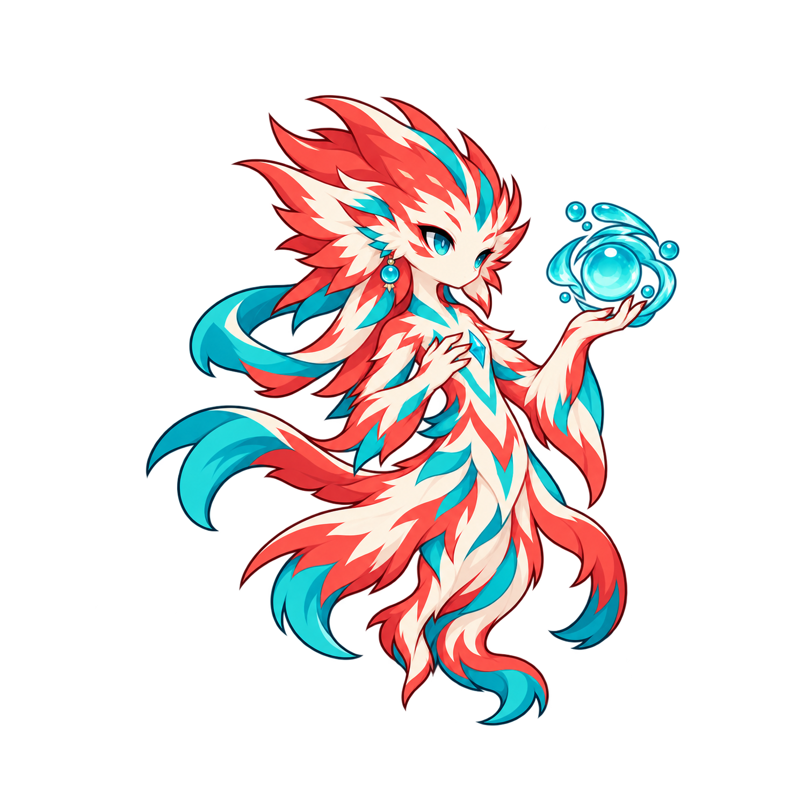

# 赤鱬 Special「回瀾」F3 v2

**CANDIDATE / PLAYER F3 REVIEW PENDING — 2026-10-24 Asia/Taipei**

只審一張角色關鍵姿勢：直立懸浮、前肘彎曲向上托珠、另一手內收胸前。右向 canonical，青色珠環在畫面右側、可見側青色耳飾保持。與 Basic 單手水平前射、Heavy 雙手推環分開；沒有把後續泉花、治療環或攻擊爆浪畫入本體。

## 本次來源與檢查

- 由 built-in imagegen 生成；完整輸入保存於 `prompt.txt`。參考已核准 Idle／identity／Basic F3／Heavy F3，四者 hash 與歷史收據／manifest 一致。
- 原圖 `originals/special-f3.png`：1254×1254 RGBA，SHA256 `ef464c46993491ebd913e65a90e4f7253c0f5dedd1912e758191f6acc64053b5`。
- 審核候選 `special-f3.png`：1510×1510 RGBA，SHA256 `f301c9a1e8ed67f6e3b481063d9f6841e826f608f4f523fc3d9d243bd8277290`。
- 原圖極淡 alpha 延伸至左界；alpha>16 的主體完整內含。未達 prompt 原生8%留白要求，因此只添加四邊128px透明留白，保留全部原始RGBA像素；不刪邊、不塗色、不重繪。嚴格 PNG verify＋完整 load、alpha0–255、像素反貼與雙鏡像檢查通過；候選透明邊界 L128/T174/R168/B154。
- [深底等尺度對照](qa-scale-dark.png)、[淺底等尺度對照](qa-scale-light.png)：沿既有審核 .13來源尺度、chestX158／hoverY203，使用作者量測原圖地標。與既有 Idle／Basic／Heavy 對照，未以放大角色強化招式。
- [淺底透明邊緣](qa-alpha-light.png)、[深底透明邊緣](qa-alpha-dark.png)、[390px靜態48px高度檢查](qa-390-static.png)已作者目視自審。小尺度可見右側托起的水珠與胸前手勢。這是靜態美術 QA，不是 Runtime／實體手機證明。
- 可重建：`python docs/art/candidates/chiru/special/f3-v2/prepare_qa.py`。完整幾何、地標、限制、hash 保存於 `manifest.json`／`checksums.sha256`。

## 必要真機制差異核對（不改產品）

基線 `7c72f4c73f47df866b562c9167e7f110b22360e1`：`src/roster/abilities.js` 的 Special 仍是範圍20／最低HP隊友／基準25%／CD7／AI門檻65%，windup0；`src/combat/effectTargeting.js` 已有存活同隊、範圍與穩定instanceId排序；`src/combat/battleSession.js` 目前仍以受益者definition基準maxHP×比例×施法者healing scale×modifier直接治療。`src/roster/catalog.js` 赤鱬只接 Basic／Heavy actionDescriptors。

核准 spec 的320ms重新選目標、受益者當前maxHp基數、T0–T3的25/30/35/40%、新主動時序／中斷與真受益者泉花尚待後續 Runtime Gate；本次未實作、不重審已核准數值。原始 batch Special prompt 含字面 `undefinedSPECIAL`，本次保存原文不改，使用完整 identity-preserve 前文重建。

## 唯一下一 Gate

呈交本張 F3，等待玩家明確核准或具體修正。核准前不做 F1／F2／F4、獨立VFX／GIF、Runtime 或部署，也不開始 Awakening／Passive。不建立 approval receipt。P1／P2、Basic／Heavy、舊損壞候選／manifest、approved masters／收據與產品來源均保持。
