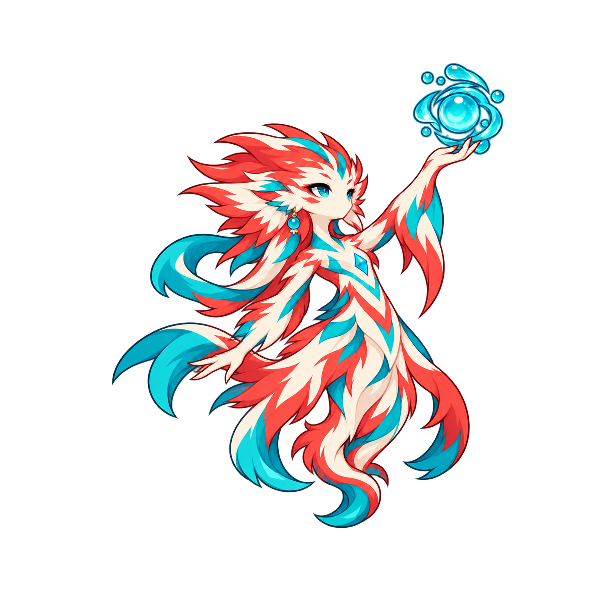

# 回瀾 Special F3 v3 — 高托／低展修正版

**CANDIDATE / PLAYER F3 REVIEW PENDING — 2026-10-24 Asia/Taipei**

## 玩家修正與新輪廓

玩家指出 v2「動作和之前技能差別不大，是蓄力一樣，打出技能不同？」並要求「確認硬規則有寫技能的動作要夠差異化和明顯大場面，繼續修改f3」。v2未獲核准；保留原圖／manifest作歷史。此指示只授權修改，不代表v3已獲玩家美術核准。

v3前臂高舉至額頭以上、掌心向上托起右側既有水珠環；另一手向下後展至腹／髖側，肩臂形成大幅上下對角。軀幹伸展、尾鰭內捲，與Basic水平單手前射、Heavy雙手推環、v2肩高托珠／胸前手勢不同。只抬一臂，為未來Awakening雙臂高V保留差異。右向canonical、畫面右側水珠環、可見側青色耳飾維持；未新增配件／腳／獨立技能特效。

## 已確認的硬規則

- `docs/CHARACTER_ACTION_ART_WORKFLOW.md` → **Mandatory within-character attack motion differentiation**：四招必須在無FX時也能立即辨認本體動作、輪廓、施力方向與節奏；不得相似蓄力只換特效。
- 同文件的 **Mandatory action-power visual escalation** 與 `docs/M5C_ART_ANIMATION_VFX.md` → **Large, unmistakable cast and impact VFX**：同手機尺度Basic＜Heavy＜Special＜Awakening；施法與真命中／真受益者效果分別具備大而清楚的視覺高峰，不能僅微調尺寸／光暈／描述。治療用恢復、泉環、泉花語言，不假造攻擊爆浪或受益事件，不放大角色／傷害幾何。
- 本張只交F3本體。完整治療施法／泉花大場面、FX-on/off動作與前招比較，仍是F3核准後的獨立VFX／GIF工作，不冒稱本張已完成全招場面。

## 來源與必要QA

- Built-in imagegen；完整prompt：`prompt.txt`。輸入為核准Idle／identity／Basic F3／Heavy F3，以及只作拒絕姿勢對照的Special v2。五份reference hash已核對。
- 原圖 `originals/special-f3.png`：1254×1254 RGBA，SHA256 `47d456cef60db7515017734e7cacc3ba8ec61b65efcf5f1015c396c78bc60f41`。
- 候選 `special-f3.png`：1510×1510 RGBA，SHA256 `1ca80dc4237cb43c810d465cc6be9f67df1d12f293eab8a359cdb0d09c273ac8`。
- 嚴格PNG verify＋完整load通過，alpha0–255。原圖L33/T29/R84/B31；只加四邊128px透明padding，保留原圖全部RGBA像素，候選L161/T157/R212/B159。像素反貼、雙鏡像與共同審核cell邊界檢查通過。
- [深底等尺度對照](qa-scale-dark.png)／[淺底等尺度對照](qa-scale-light.png)：Idle、Basic、Heavy、未接受v2、新v3並列。沿用原圖.13倍率、chestX158/hoverY203，未加大v3倍率；頭部姿態與輪廓仍是玩家美術審核內容，不宣稱像素相同。
- [淺底邊緣](qa-alpha-light.png)／[深底邊緣](qa-alpha-dark.png)／[390px靜態48px高度](qa-390-static.png)：作者靜態自審可見高托與低手輪廓，不是Runtime／實體手機通過。
- 可重建 `python docs/art/candidates/chiru/special/f3-v3/prepare_qa.py`；完整幾何／地標／限制與指紋見 `manifest.json`、`checksums.sha256`。

## 下一步

只呈交v3，等待玩家明確核准／修正。沒有Special acceptance，不做F1/F2/F4、獨立VFX／GIF、Runtime或部署。核准數值／320ms時序不改、不重審；必要真Runtime差異已在v2 REVIEW／Special WORK_LOG記錄，未重做既有驗證。P1/P2、Basic/Heavy、全部approved masters／收據、舊v2與損壞batch保持。原分支／PR#1 open-unmerged、單人、無新branch/worktree/TD/main merge；美術文件checkpoint [skip ci]。
