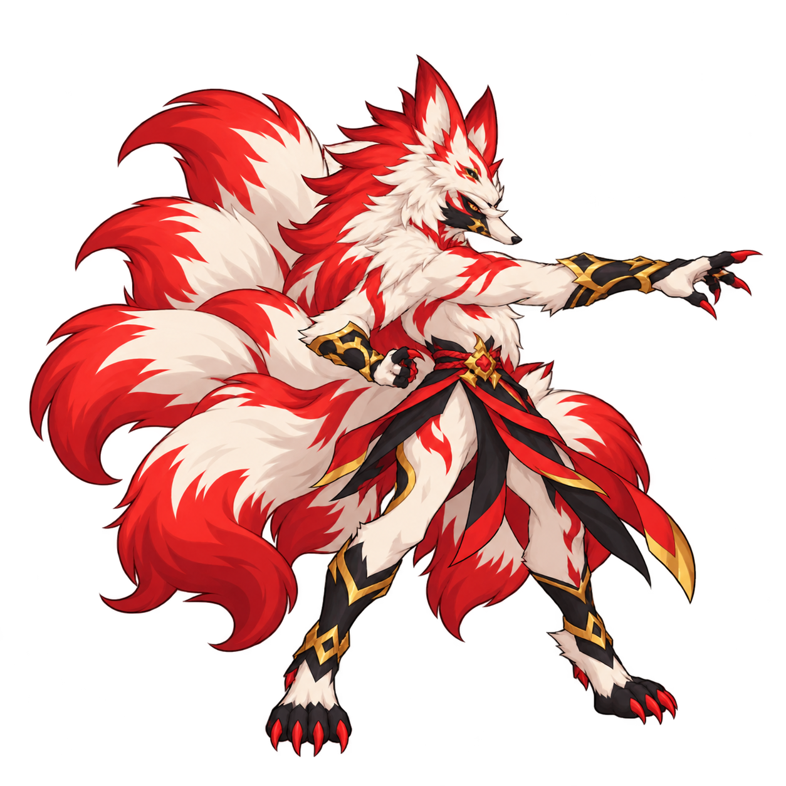

# P4 九尾狐 Basic「靈火」單張F3 v1

**CANDIDATE / PLAYER ART REVIEW PENDING**。先前整角規格核准收據 `docs/verification/P4_CHARACTER_PREFLIGHT/spec-acceptance.json` 不等於本圖核准。

本圖只審角色本體關鍵姿勢：右向、單臂向前短促點出、另一臂收腰，保留狐形長吻、乳白/暖紅/黑金配色、分組九尾與既有服裝。與核准Idle單手抬火準備姿勢不同；無獨立火團/飛行/命中VFX、無背景/UI/文字。本體不能靠特效掩蓋動作差異。

使用內建imagegen，兩個已核准真PNG作reference。1254×1254 RGBA原檔完整解碼、原bytes保存；精確prompt見prompt.txt，QA/hash/reference綁定見qa.json。原始圖有alpha=1極淡像素觸及左/下畫布邊，alpha>1主體bbox (44,84)–(1220,1210)，可見四邊留白44/84/34/44px；沒有宣稱已完成frame-safe/common-anchor Runtime包裝。F3核准後才沿原像素製作必要padding/共同尺度衍生，保留此原檔。

本次原生單人自審，非獨立review；保留核准reference，不更新src/public或Collection。新圖仍由玩家決定是否接受，未生成F1/F2/F4、獨立VFX/GIF或Runtime，沒有Build/Browser/Pages。Basic真結算0ms契約不變。

唯一下一Gate：玩家審核本F3。核准後保存本次精確PNG SHA256收據，沿核准姿勢完成其餘Basic動作與獨立出手/真命中VFX及GIF；停待GIF核准，再Runtime/必要真驗證/正常Pages/public/玩家遊戲核准。未完成Basic不開始Heavy。
